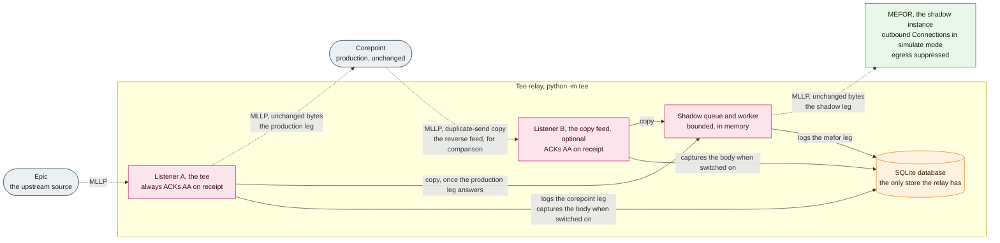

# Tee relay — parallel-run validation for a Corepoint → MessageFoundry cutover

> **For test data only.** The tee relay is a **validation** tool for de-risking a migration. It prints a
> warning at every start and is **not** hardened to carry production PHI. Point it only at **test /
> synthetic** feeds and endpoints. (Backlog #14.)

The tee relay (`python -m tee`) is a small, **standalone** application — no `messagefoundry` imports, just
a vendored MLLP codec and SQLite. It lets you run MessageFoundry **alongside** a live Corepoint instance on
real-shaped traffic and validate that MEFOR produces equivalent output **before** any feed is actually
cut over — with rollback being "just stop the relay."

> **Adopters:** "Epic" and "Corepoint" below are the common case (an Epic EHR feeding the Corepoint engine
> you're replacing). They generalize: the **`--listen-epic`** leg is whatever upstream source sends to your
> legacy engine, the **`--corepoint`** leg is whatever engine you're migrating *off*, and **`--mefor`** is
> the shadow MessageFoundry instance.

## What it does

### The relay forwards to production and copies to the shadow

This diagram shows where each copy of a message goes during a parallel run. The source sends MLLP to
the tee relay, which always ACKs on receipt and forwards the unchanged bytes to Corepoint, the
production path. Once Corepoint answers, the relay queues a copy for MEFOR, the shadow instance,
whose own outbound Connections are set to `simulate` mode so that its egress is suppressed. An
optional second listener takes the copies Corepoint sends of its own output, the reverse feed, for
comparison.

**Legend.** A dotted arrow is an MLLP hop between processes. A solid arrow stays inside the relay
process and its SQLite file: a queued copy, a log row, or a captured body. The tee relay is one
process and imports no engine code. Grey is a system outside MessageFoundry, pink is the tee relay,
green is the shadow MessageFoundry instance, and orange is a store.



* **Listener A — the tee (`--listen-epic`).** Repoint Epic's outbound at the relay. For every message it
  **always ACKs `AA` on receipt** (it is the ACK authority to Epic), then forwards the **unchanged** bytes
  to **both** Corepoint (the live production path) and MEFOR (shadow).
* **Listener B — the copy feed (`--listen-corepoint-copy`, optional).** MEFOR can't be inserted into the
  `Corepoint → Epic` path without changing it, so add a **duplicate outbound send in Corepoint's
  configuration** that mirrors those outbound messages to this listener; the relay ACKs and forwards them
  to MEFOR.

The point is **parity**: MEFOR sees the same inputs (and Corepoint's outputs) so you can compare MEFOR's
transformed/routed output against Corepoint's — without MEFOR delivering to real downstreams.

## Behaviour you must understand

* **Always-ACK trade-off.** Because the relay always `AA`s on receipt, a Corepoint *application-level* NAK
  (`AE`/`AR`) **does not propagate back to Epic** — Epic sees the relay, not Corepoint. That's why the
  relay **logs every NAK** (see below). Corepoint still NAKs internally; transport failures are surfaced
  via the fail-closed shutdown.
* **Fail-closed.** On a Corepoint **transport** failure (unreachable, after `--corepoint-attempts` quick
  retries), the relay **stops accepting on Listener A and drops live Epic connections** so Epic sees the
  outage and queues/retries on its side. It does **not** exit (so it can't crash-loop against a down
  Corepoint) — **restart it once Corepoint is healthy.** A message in flight at the instant of the failure
  may be `AA`'d-but-undelivered; the shutdown bounds further loss and Epic's resend/queue covers the rest.
  (This is a simple fail-closed relay, **not** durable store-and-forward — by design.)
* **Shadow leg is decoupled.** The MEFOR copy goes through a bounded in-memory queue drained by its own
  worker, so a slow/down MEFOR **never** back-pressures or trips the production (Corepoint) path. If the
  queue fills, the oldest copy is dropped with a log.

## Pairing with MEFOR's `simulate` mode

The shadow MEFOR must process the traffic **without delivering to live partners** (Corepoint is still
doing the real sending). Run its outbound connections in **`simulate`** mode (engine backlog #15) so MEFOR
exercises the full route/transform pipeline and captures what it *would* have sent, with egress suppressed.

## Usage

```bash
# Repoint Epic at :6661; fan out to Corepoint and a shadow MEFOR; log to ./tee.db
python -m tee run \
    --listen-epic :6661 \
    --corepoint corehost:5000 \
    --mefor meforhost:2575 \
    --db ./tee.db

# Also receive the Corepoint -> Epic copy feed
python -m tee run --listen-epic :6661 --corepoint corehost:5000 --mefor meforhost:2575 \
    --listen-corepoint-copy :6662 --db ./tee.db

# Read back the most recent NAKs / transport errors
python -m tee naks --db ./tee.db
```

Useful flags: `--corepoint-attempts` / `--corepoint-retry-delay` (quick retries before tripping
fail-closed), `--connect-timeout` / `--send-timeout`, `--max-frame-bytes` (frame-size DoS cap),
`--mefor-queue-max` (shadow buffer bound), `--capture-bodies` (persist full bodies — **test data only**),
`-y/--yes` (skip the test-data-only confirmation for an unattended/service start), `--log-level`.

## The SQLite log

The relay's only store is SQLite. It records **one row per forwarding leg** (`corepoint` / `mefor`) with
the outcome, the ACK code, the control id (MSH-10), the message type (MSH-9), the size, and a bounded,
control-char-scrubbed `detail` (the MSA-3 reason or an error string). **Message bodies are never logged**;
they are persisted only to a separate `relay_capture` table, and only when `--capture-bodies` is set.

`python -m tee naks` prints the recent NAKs (`AE`/`AR`/`CE`/`CR`) and transport errors — the otherwise-
invisible record of anything a downstream rejected for a message Epic was told `AA`.

### Export for review (incl. AI analysis)

`python -m tee export` writes the log as **JSON** — a `summary` (counts by leg / outcome / ACK code,
NAK count, distinct messages, time range) plus the matching `rows`. It never holds the captured
message bodies, but it is **not PHI-safe**: a row's `detail` can carry at least the partner's
MSA-3 ACK text or a transport error string, written verbatim apart from control characters and a
500-character cap, and either can name a patient. `python -m tee naks` prints the same detail. Treat an export as PHI, and check it before you hand it to a reviewer or an AI session.
Default is stdout; use
`--out FILE` to write a file. Narrow it with `--since` / `--before` (an age like `24h`/`7d` or a UTC date
`YYYY-MM-DD`), `--naks-only`, and `--limit N`.

```bash
python -m tee export --db ./tee.db --naks-only --since 24h --out ./tee-review.json
```

### What `--out` does to the file

`export --out`, `anonymize-captures --out` and `compare --out` share one writer,
`_write_owner_only` in `tee/__main__.py`, which is the source of record. At least these
consequences follow from it:

* **On POSIX a new file's mode is never wider than `0600`**, whatever the umask.
* **On POSIX an existing file is replaced, not written into.** A read-only (`0444`) file is
  overwritten, a hard link at the path is broken (the other name keeps the old contents), and a
  symbolic link at the path is replaced. On POSIX, a target that resolves, through any link, to a
  character device, or to anything else that is neither a regular file nor a directory and that
  this account owns, such as a pipe, is opened for writing in place instead of replaced; the open
  can be refused, for example for a socket, and that is an error and exit 1. These hold for all
  three commands.
* **`export` and `anonymize-captures` write LF line endings on every OS**, Windows included. Before
  vault BACKLOG #3166 a Windows `export` file ended its lines in CRLF.
* **On Windows, `export` and `anonymize-captures` write an existing file in place**, as `write_text`
  did before #3166. It keeps its access list and owner, whatever they hold, so a file another
  account created there first stays that account's. A link to a file at the path is followed and
  the file it names is written in place. The write is not atomic, so a failure part way leaves the
  file truncated or partly written. A file the open refuses is an error and exit 1, never replaced:
  at least one this account may not write, a read-only, Hidden or System one, a directory, and one
  another process holds open without write sharing. A new file takes its folder's access list.
* **compare replaces an existing regular file; the replace can be refused, for example for a
  read-only file on Windows.** On Windows the report takes its folder's access list, whatever list
  the old file had, so an access list hardened on the old file is not kept, and a link to a regular
  file is replaced. On Windows compare opens a target that resolves, through any link, to anything
  that is neither a regular file nor a directory, such as NUL or CON, for writing in place instead
  of replacing it; the open can be refused, for example for a named pipe, and that is an error and
  exit 1. It writes the platform's line endings.

### Purge

`python -m tee purge` clears the log DB. It reclaims disk (`VACUUM`) only when a run deletes a
row, and `--scrub-only`, below, reclaims it on demand. With no `--before` it purges
**everything**; `--before <age|date>` deletes only older rows (retention); `--captures-only` drops just
the captured bodies (the PHI-bearing table) and keeps the NAK/leg log. It **prompts for confirmation**
(or refuses, in a non-interactive shell) unless you pass `-y`.

The DB runs in WAL mode, so a deleted row stays in the DB file or its `-wal` file until the
scrub removes it. When a run deletes at least one row, purge then scrubs:
a `TRUNCATE` checkpoint, `VACUUM`, and a second checkpoint. That includes a run that deletes only
log rows. A log row holds no message body, but its detail can carry partner ACK text that
names a patient. `VACUUM` is part of the scrub. The store zeroes deleted content inside a page
only where that costs no extra I/O, and leaves a freed page as it was. A B-tree rebalance can also
leave a stale copy of a deleted row in a page's unused space. Only the rebuild removes these. A
run that deletes no row still scrubs if residue remains: the DB has free pages, or the `-wal` file
is not empty. So a plain re-run after a failed scrub scrubs only while free pages or a non-empty
`-wal` remain. A failed `VACUUM` can leave neither, so use `purge --scrub-only`, which always runs
the whole scrub and exits 1 if it still does not finish. A live relay's writes
keep the `-wal` non-empty, so a sweep beside a running relay scrubs every time. Only a run with no
deletes and no residue skips the scrub.

**The scrub is file-level only.** A checkpoint frees the `-wal` file's blocks and `VACUUM` shrinks
the DB file, but neither overwrites the freed blocks. So the bytes can stay readable on the raw
volume, and nothing here touches a copy or backup taken before the purge. [PHI.md section
8](PHI.md#8-retention--purge) states the same limit for the engine store. Put the volume of every
tee DB, capture on or off, under full-disk encryption, as [section 10](PHI.md#10-secure-deployment--operations-checklist) advises.

`VACUUM` builds its rebuilt copy in a temp file in SQLite's temp directory, which can be on
another volume. Purge sets `temp_store=FILE` for the `VACUUM`, because in memory a large capture DB
would fail every purge. A SQLite build compiled to keep temp files in memory
(`SQLITE_TEMP_STORE=3`) ignores that setting. To keep the copy on a protected volume, point SQLite's temp directory there
before you run purge. On POSIX, SQLite tries `SQLITE_TMPDIR`, then `TMPDIR`, then its default
directories such as `/var/tmp` and `/tmp`, and silently skips one that is missing or not
writable, so a mistyped setting puts the copy in a default directory with nothing reported. On
Windows it takes the first of `TMP`, `TEMP` and `USERPROFILE` that is set, then the Windows
directory, without checking that it exists. A missing directory then makes `VACUUM` fail, and the
scrub report `VACUUM failed`, but only once the copy outgrows SQLite's page cache: a small test DB
can `VACUUM` without error. Check that the directory exists and the purge account can write to it.

If the scrub does not finish, purge prints `error: ...` and exits 1. The error names the counts it
deleted and the step that failed. At least these failures do that:

* a checkpoint that cannot finish within about 5 s, because another connection holds a read
  transaction open or another writer or checkpoint runs;
* a failed `VACUUM`, for example out of memory or a full disk;
* an SQLite error, or an out-of-memory error, from a checkpoint.

The scrub runs only after the delete has committed. So when one of those errors prints, the rows
it counts are gone, but their bytes may still be in the DB file or its `-wal` file. A failure
before the commit, such as the delete itself timing out, deletes nothing. Other failures end purge with a traceback, at least these: Ctrl-C, which
prints no counts; and an error while closing the store after a scrub error, which prints the
`error: ...` line with the counts and then a traceback.

To finish an unfinished scrub, run `python -m tee purge --db ./tee.db --scrub-only` once the cause
is gone. It deletes nothing and needs no `-y`, and it refuses a `--db` path that does not exist. It exits 1 with `error: ...` if the scrub still
does not finish, and prints `scrubbed <db>` when it does.

```bash
python -m tee purge --db ./tee.db --before 7d -y          # retention sweep
python -m tee purge --db ./tee.db --captures-only -y      # drop only the captured bodies
```

## Limits (by design, for the test-only scope)

* **Test data only** — not hardened for production PHI (no at-rest encryption; the DB is `chmod 0600`
  best-effort only). Keep every tee DB on a protected volume, capture on or off, because a log row's
  detail can name a patient. Enable `--capture-bodies` only with test data.
* **Not store-and-forward** — no durable retry queue; recovery of post-trip traffic is delegated to Epic's
  resend/queue (see *Fail-closed* above).
* **One connection per forward** — the relay dials a fresh MLLP connection per forwarded message (simple
  and robust; not tuned for peak throughput).
* **No concurrent-connection cap** on the listeners (the engine caps at 256); fine behind a trusted,
  test-environment network, which is the only place this should run.
